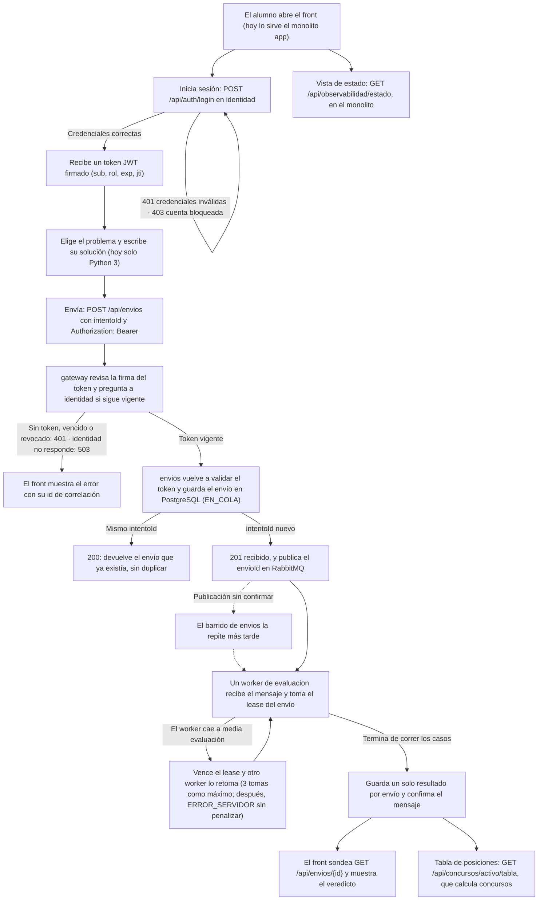
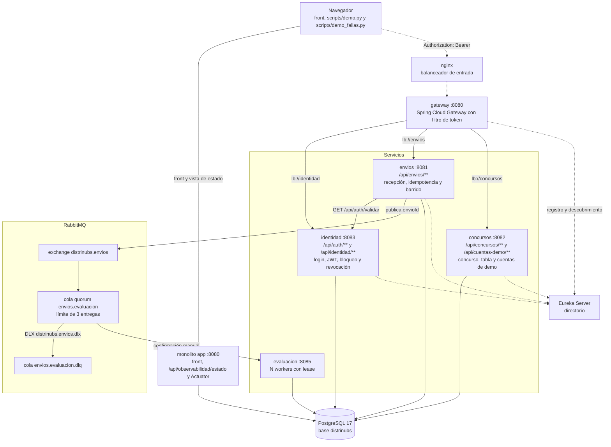
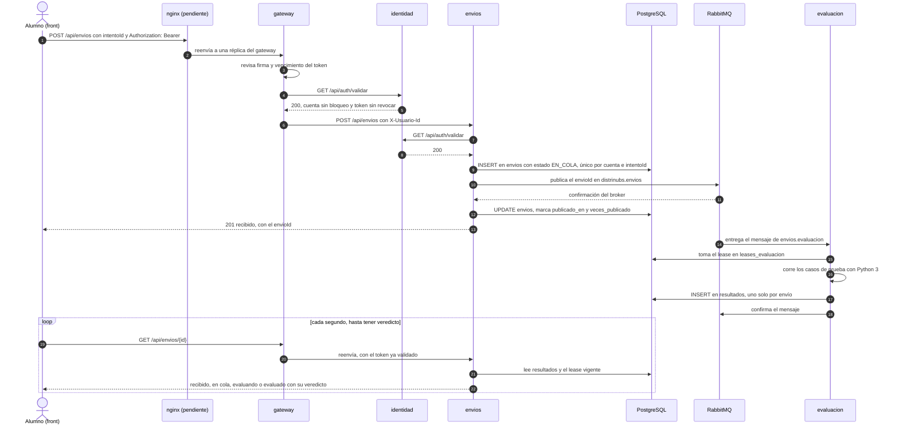

# Arquitectura de Distrinubs

Distrinubs es un juez en línea para práctica y concursos de programación competitiva: el alumno sube una solución, el sistema la evalúa contra casos de prueba y publica el veredicto y la tabla de posiciones.

Este documento describe la etapa 2, que separa el monolito en servicios. Dibuja lo que existe en el código al 28/11/2026, en `02-separacion` y en las ramas personales que faltan por integrar, y marca aparte lo que sigue pendiente.

## Diagrama funcional

El recorrido del alumno y del sistema, desde el inicio de sesión hasta el veredicto, la tabla y la vista de estado.

## Diagrama de arquitectura

Los contenedores de la etapa 2 y cómo se comunican.

**Leyenda.** Línea sólida: hay código que lo hace, en `02-separacion` o en una rama por integrar. Línea punteada: pendiente de integrar.

- `gateway` y `concursos` ya están en `02-separacion`. `envios`, `identidad`, el filtro de token del gateway, `evaluacion`, el front nuevo y la vista de estado están en ramas personales que faltan por integrar.
- Los servicios ya traen el cliente de Eureka y el gateway enruta con `lb://`, pero ninguna rama tiene todavía el servidor Eureka, la configuración de nginx ni el `docker-compose.yml` de la etapa 2. El Compose actual solo levanta la base de datos y el monolito.
- El gateway valida el token en dos pasos: revisa la firma y el vencimiento con el secreto compartido, y después consulta `GET /api/auth/validar` en `identidad` para saber si la cuenta está bloqueada o el token revocado. Si `identidad` no responde, rechaza con 503. `envios` repite la misma validación.
- El gateway todavía no tiene ruta hacia el front ni hacia `/api/observabilidad/estado`: se entra a ellos directo por el monolito, que usa el mismo puerto 8080 por omisión.
- De los servicios, `identidad`, `envios` y `concursos` traen el cliente de Eureka. `evaluacion` no se registra: no recibe peticiones, consume de la cola.
- La vista de estado puede consultar `/actuator/health` de cada servicio, pero sus URL todavía no están configuradas, así que hoy los reporta como `NO_DISPONIBLE`.

**Planeado, no implementado.**

- `marcador` como servicio aparte: el gateway ya tiene la ruta `/api/marcador/**`, pero el servicio no existe. La tabla de posiciones la calcula `concursos`.
- Redis, para la caché del marcador o para sesiones y revocación.
- Gateway en 2 réplicas detrás de nginx: el gateway no guarda estado, pero falta el Compose que lo escale.
- C++, C, Java y JavaScript: `envios` ya admite esos valores en su tabla, pero solo acepta `PYTHON3` y `evaluacion` solo ejecuta Python 3.
- Id de correlación en los logs de los servicios separados: hoy solo lo tiene el monolito.
- Consumidor de la cola de mensajes muertos, circuit breaker en el gateway y sandbox por envío.

## Flujo de un envío de punta a punta

Lo que sostiene este flujo cuando algo falla:

- **El estado manda en PostgreSQL, no en el mensaje.** El mensaje solo lleva el `envioId`. Si la publicación no se confirma, el envío queda guardado y el barrido de `envios` lo publica más tarde.
- **El lease decide quién evalúa.** Si un worker muere sin confirmar, RabbitMQ entrega el mensaje a otro, y ese otro espera a que venza el lease del caído antes de tomarlo.
- **Un envío se toma 3 veces como máximo.** Si las agota sin resultado, queda con `ERROR_SERVIDOR`, que no penaliza al alumno. La cola quorum tiene además un límite de 3 entregas: lo que lo supera va a `envios.evaluacion.dlq`, y un barrido de `evaluacion` cierra los envíos que se quedaron sin mensaje.
- **Un resultado por envío.** La unicidad en `resultados` evita que dos workers cuenten el mismo envío dos veces.

## Dónde viven los datos

Todos los servicios usan la misma base `distrinubs` en PostgreSQL. Cada tabla tiene un solo servicio que escribe en ella; los demás solo la leen.

| Tabla | Servicio dueño | Quién la lee |
|---|---|---|
| `cuentas` | `identidad` | `envios` y la tabla de posiciones |
| `tokens_revocados` | `identidad` | Nadie más |
| `concursos` y `problemas` | `concursos` | `envios`, `evaluacion` y la tabla de posiciones |
| `casos_prueba` | `concursos` | `evaluacion` |
| `envios` | `envios` | `evaluacion` y la tabla de posiciones |
| `leases_evaluacion` | `evaluacion` | `envios`, para mostrar "evaluando" y para su barrido |
| `resultados` | `evaluacion` | `envios` y la tabla de posiciones |

- La tabla de posiciones no tiene tablas propias: `concursos` la calcula leyendo las de otros.
- Excepción temporal: `concursos` todavía siembra las cuentas de demo en `cuentas`, hasta que esa siembra quede solo en `identidad`.
- Cada servicio trae las migraciones de las tablas que usa y las aplica sobre la misma base, sin detenerse por las migraciones de otros servicios que no trae. Falta acordar en el Compose quién las ejecuta primero.

## Manejo de fallas

Los tres casos de `scripts/demo_fallas.py`. Si falta alguna pieza, el script lo reporta como "no disponible" y no como éxito.

| Caso | Qué se provoca | Qué se espera ver |
|---|---|---|
| 1. Worker muerto a media evaluación | Se mata con `SIGKILL` el contenedor del worker que tiene el lease del envío | El envío pasa de "evaluando" a "en cola" y otro worker lo retoma al vencer el lease: termina en `ACCEPTED` y el lease muestra la reentrega (`veces_tomado` crece o cambia el worker) |
| 2. Réplica del gateway apagada | Se detiene una de las réplicas del gateway con `docker stop` | Ocho peticiones seguidas por la entrada responden HTTP 200: el alumno no nota el corte |
| 3. Instancia caída en Eureka | Se mata con `docker kill` el contenedor de una instancia registrada, sin que se dé de baja | Al dejar de mandar latidos, la instancia deja de figurar `UP` en `/eureka/apps`; el script informa cuántos segundos tardó |

El caso 1 se comprobó de punta a punta contra dos réplicas del monolito. Los casos 2 y 3 necesitan el Compose de la etapa 2, con el gateway en réplicas y Eureka, que todavía no existe.
