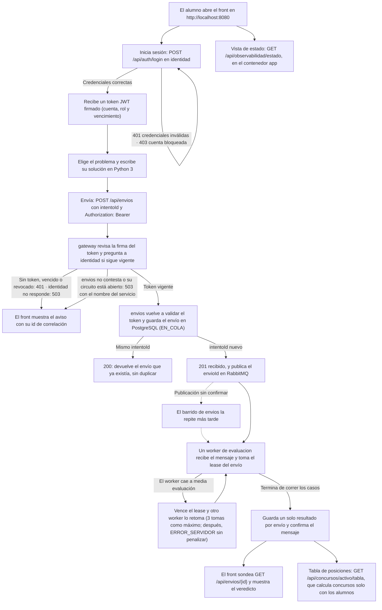
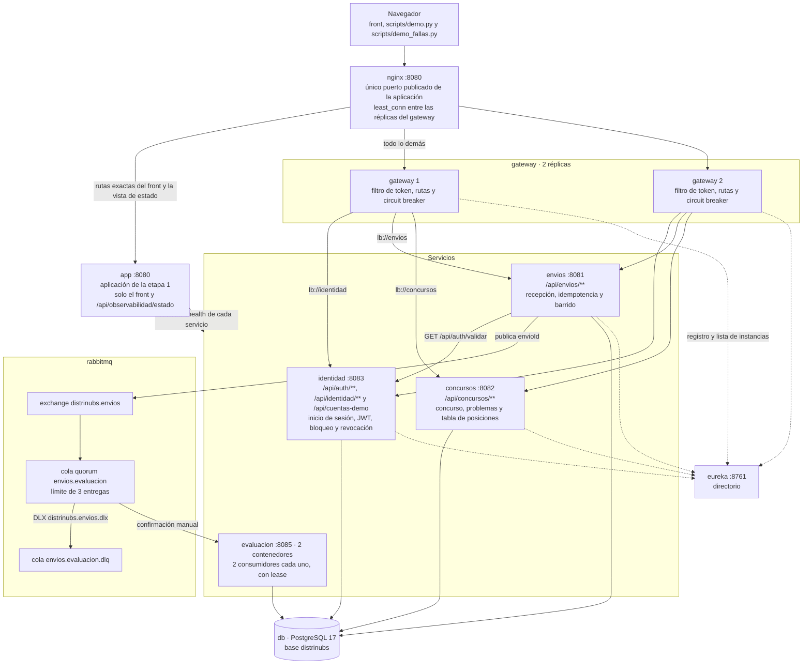
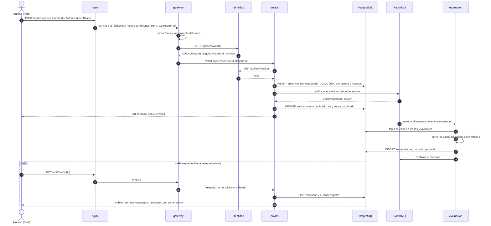

# Arquitectura de Distrinubs

Distrinubs es un juez en línea para práctica y concursos de programación competitiva: el alumno sube una solución, el sistema la evalúa contra casos de prueba y publica el veredicto y la tabla de posiciones.

Este documento describe la etapa 2, que separa el monolito en servicios. Dibuja lo que levanta el `docker-compose.yml` de `02-separacion` al 28/11/2026 y marca aparte lo que está planeado y no existe.

## Diagrama funcional

El recorrido del alumno y del sistema, desde el inicio de sesión hasta el veredicto, la tabla y la vista de estado.

## Diagrama de arquitectura

Los contenedores que levanta el Compose y cómo se comunican. Todas las flechas existen en el código.

**Leyenda.** Línea sólida: una petición o un mensaje. Línea punteada: registro en el directorio y consulta de la lista de instancias.

- **nginx** es la entrada única. Manda al contenedor `app` solo las rutas exactas del front y de la vista de estado; todo lo demás va a la réplica del gateway con menos conexiones activas. Si una réplica no contesta, la petición pasa a la otra y la caída se deja de usar 10 s. `/actuator` responde 404 desde afuera.
- **gateway** valida el token en dos pasos: revisa la firma y el vencimiento con el secreto compartido, y consulta `GET /api/auth/validar` en `identidad` para saber si la cuenta está bloqueada o el token revocado. Si `identidad` no responde, rechaza con 503. `envios` repite la misma validación.
- **Circuit breaker:** hay un circuito por servicio destino. Cuenta como falla una petición que no llegó al servicio. Con 5 llamadas y la mitad fallidas, abre 10 s y responde 503 con el nombre del servicio, sin intentar la llamada. Cada réplica lleva su propio circuito.
- **Eureka:** se registran `gateway`, `identidad`, `concursos` y `envios`. `evaluacion` no: no recibe peticiones, consume de la cola. Cada servicio renueva su registro cada 5 s y el registro vence a los 15 s; el directorio revisa cada 5 s, con la auto-preservación apagada.
- **`app`** es la aplicación de la etapa 1 con su evaluación y su siembra apagadas. Solo sirve el front y la vista de estado, que consulta `/actuator/health` de cada servicio por la red interna.
- **Puertos publicados:** `8080` (nginx) y, solo en `127.0.0.1`, `8761` (Eureka), `15672` (consola de RabbitMQ) y `5432` (PostgreSQL), para la demo de fallas y para inspección.

**Planeado, no implementado.**

- `marcador` como servicio aparte, con mensajes de resultado. El gateway ya tiene la ruta `/api/marcador/**`, pero el servicio no existe: la tabla de posiciones la calcula `concursos`.
- Redis, para la caché del marcador o para sesiones y revocación.
- C++, C, Java y JavaScript: el esquema ya admite esos valores, pero `envios` solo acepta `PYTHON3` y `evaluacion` solo ejecuta Python 3.
- Sandbox por envío y límite de memoria: el código del alumno corre como proceso hijo de `evaluacion`.
- Id de correlación en los logs de los servicios separados: nginx lo genera y lo manda, y hoy solo lo escriben nginx y `app`.
- Consumidor de la cola de mensajes muertos: la cola recibe los mensajes rechazados, pero nadie la lee.
- Renovación de lease, evaluación final e interfaz de organizador.

## Flujo de un envío de punta a punta

Lo que sostiene este flujo cuando algo falla:

- **El estado manda en PostgreSQL, no en el mensaje.** El mensaje solo lleva el `envioId`. Si la publicación no se confirma, el envío queda guardado y el barrido de `envios` lo publica más tarde.
- **El lease decide quién evalúa.** Si un worker muere sin confirmar, RabbitMQ entrega el mensaje a otro, y ese otro espera a que venza el lease del caído antes de tomarlo.
- **Un envío se toma 3 veces como máximo.** Si las agota sin resultado, queda con `ERROR_SERVIDOR`, que no penaliza al alumno. La cola quorum tiene además un límite de 3 entregas: lo que lo supera va a `envios.evaluacion.dlq`, y un barrido de `evaluacion` cierra los envíos que se quedaron sin mensaje.
- **Un resultado por envío.** La unicidad en `resultados` evita que dos workers cuenten el mismo envío dos veces.

## Dónde viven los datos

Todos los servicios usan la misma base `distrinubs` en PostgreSQL. Cada tabla tiene un solo servicio que escribe en ella; los demás solo la leen.

| Tabla | Servicio dueño | Quién la lee |
|---|---|---|
| `cuentas` | `identidad` | `envios` y la tabla de posiciones |
| `tokens_revocados` | `identidad` | Nadie más |
| `concursos` y `problemas` | `concursos` | `envios`, `evaluacion` y la tabla de posiciones |
| `casos_prueba` | `concursos` | `evaluacion` |
| `envios` | `envios` | `evaluacion` y la tabla de posiciones |
| `leases_evaluacion` | `evaluacion` | `envios`, para mostrar "evaluando" y para su barrido |
| `resultados` | `evaluacion` | `envios` y la tabla de posiciones |

- La tabla de posiciones no tiene tablas propias: `concursos` la calcula leyendo las de otros, solo con las cuentas de alumno.
- Cada servicio aplica sus migraciones al arrancar, sobre la misma base, y tolera las de los demás. No hay un contenedor aparte que migre.
- RabbitMQ y Eureka no son fuente de verdad: la cola se puede volver a llenar con el barrido de `envios` y la lista de instancias se reconstruye con las renovaciones.

## Manejo de fallas

Los tres casos de `scripts/demo_fallas.py`, medidos el 28/11/2026 con el Compose de la etapa 2. Las salidas completas están en [evidencia/](evidencia/).

| Caso | Qué se provoca | Qué se vio |
|---|---|---|
| 1. Worker muerto a media evaluación | Se mata con `SIGKILL` el contenedor del worker que tiene el lease del envío | Otro worker retomó el envío como toma 2 y lo dejó en `ACCEPTED` entre 24 y 25 s después del kill, con un solo resultado |
| 2. Réplica del gateway apagada | Se detiene una de las réplicas del gateway con `docker stop` | 8 de 8 peticiones por la entrada respondieron HTTP 200, en 10 de 10 corridas seguidas. A lo más una petición por corrida tardó cerca de 1 s, lo que nginx espera a la réplica apagada antes de pasar a la otra |
| 3. Instancia caída en Eureka | Se mata con `docker kill` el contenedor de una instancia registrada, sin que se dé de baja | La instancia dejó de figurar `UP` en `/eureka/apps` entre 30 y 34 s después del kill |

Fuera del script se midió el circuit breaker: con `concursos` muerto, cada petición a su ruta tardó 2 s (el tiempo de espera para conectar) hasta que el circuito abrió, tras 8 peticiones entre las dos réplicas. Con el circuito abierto, el 503 llegó en 7 ms. Al arrancar `concursos` de nuevo, la ruta volvió a responder 200 a los 11 s.

También se comprobó la cola de mensajes muertos: un mensaje sin `envioId`, publicado a mano en `envios.evaluacion`, terminó en `envios.evaluacion.dlq`.

Lo que no tiene respaldo: nginx, Eureka, RabbitMQ y PostgreSQL corren en un solo contenedor cada uno, y todo corre en una computadora. Si cae Eureka, el gateway sigue con la última lista que guardó. Si cae nginx, PostgreSQL o la computadora, el sistema no responde hasta que vuelvan; lo ya guardado sobrevive.
