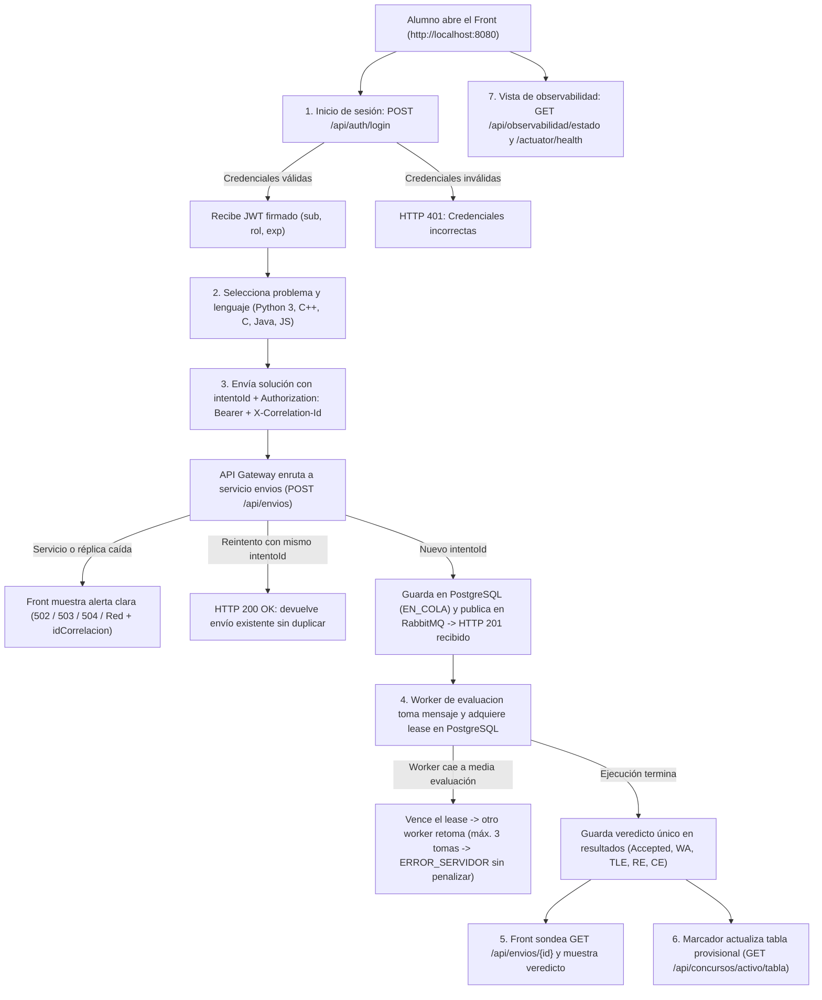
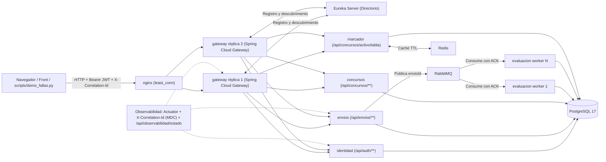

# Aporte al Reporte Final y Pitch · Diego Contreras (`@diegocontrras`)

Este documento reúne las secciones asignadas a **Diego** en `docs/PLAN.md` para su integración en `docs/reporte-final.pdf` y la presentación (pitch) de la etapa `02-separacion`.

---

## 1. Diagrama funcional

Flujo completo desde la perspectiva del alumno y del sistema: autenticación con token, envío idempotente, evaluación asíncrona con lease, consulta de veredicto, tabla de posiciones y monitoreo de observabilidad.



---

## 2. Diagrama de arquitectura

Vista de despliegue en contenedores de la etapa `02-separacion` (entrada balanceada, gateway sin estado, directorio de servicios, mensajería, caché y base de datos).

> Nota: Para revisión de `gateway`, `Eureka` y `nginx` con Joshua y Emiliano.



---

## 3. Decisiones de arquitectura del área (con lo que se dejó atrás)

1. **Propagación de fallas explícita en el front con ID de correlación**
   - **Decisión:** Centralizar todas las llamadas HTTP del front hacia el Gateway en una sola función que adjunta `Authorization: Bearer <token>` y `X-Correlation-Id`, y que distingue errores de red, `502`, `503`, `504` y `401` mediante un banner visible con el ID de correlación para rastrear la petición en logs.
   - **Alternativas descartadas:** Mostrar errores genéricos de consola o reintentar indefinidamente en silencio, lo cual oculta al usuario qué servicio falló y dificulta depurar en la demo de fallas.

2. **Observabilidad mínima integrada en la aplicación (Actuator + MDC + endpoint de estado)**
   - **Decisión:** Implementar un filtro `OncePerRequestFilter` (`FiltroCorrelacion`) que inserta `idCorrelacion` en el MDC de SLF4J y lo incluye en el patrón de consola, junto con Spring Boot Actuator (`health`, `info`, `metrics`) y una vista dedicada en `/api/observabilidad/estado` consumida por el front.
   - **Alternativas descartadas:** Desplegar desde el primer corte la pila completa de Prometheus, Grafana y Jaeger, ya que consume más memoria en una sola máquina y queda como opcional una vez estable lo obligatorio.

3. **Script de demostración de fallas reales (`scripts/demo_fallas.py`)**
   - **Decisión:** Construir un script en Python estándar (sin dependencias externas) que provoca las fallas reales sobre los contenedores de Docker (`docker kill` / `docker stop`) y verifica el resultado observando las respuestas HTTP y el registro de Eureka. Si alguna pieza (`gateway`, `evaluacion` en réplicas o Eureka) no existe o no responde, el script lo informa como `NO DISPONIBLE` y termina con error sin simular éxitos.
   - **Alternativas descartadas:** Imprimir salidas simuladas o ejecutar comandos ad-hoc en terminal durante la presentación, lo cual no demuestra tolerancia a fallas real ni es reproducible.

---

## 4. Manejo de fallas (Demo del Paso 4)

El script `scripts/demo_fallas.py` cubre los tres escenarios obligatorios y muestra qué ocurre en el sistema y qué ve el usuario en cada uno:

| Caso | Falla provocada | Qué ocurre internamente | Qué ve el usuario / operador |
|---|---|---|---|
| **1. Worker muerto a media evaluación** | Se interrumpe un worker mientras evalúa un envío con lease activo en `leases_evaluacion`. | El resultado no se guarda; al vencer `vence_en`, otro worker toma el envío. La restricción única en `resultados` impide duplicados. Si agota 3 tomas, queda `ERROR_SERVIDOR`. | El estado pasa de `evaluando` a evaluado con veredicto único (o aviso de error de servidor). **Cero penalización** para el alumno. |
| **2. Réplica del Gateway apagada** | Se detiene una de las 2 réplicas del Spring Cloud Gateway detrás de `nginx`. | `nginx` (`least_conn`) detecta la falla de conexión y redirige las peticiones a la réplica sana. | El front sigue operando con HTTP 200 OK sin pérdida de sesión ni caídas visibles. |
| **3. Instancia caída saliendo de Eureka** | Se detiene una instancia de servicio sin desregistro limpio. | Deja de enviar *heartbeats*; al expirar su lease en Eureka, el servidor la expulsa del registro y el Gateway deja de enrutar hacia ella. | La instancia desaparece de Eureka (`DOWN`/expulsada) y se evitan errores 502 repetidos hacia esa instancia. |

---

## 5. Cómo levantarlo y probarlo

Requisito: Docker y Docker Compose (opcionalmente Python 3 en el host para ejecutar los scripts directamente).

1. **Levantar el sistema desde cero:**
   ```bash
   docker compose down -v
   docker compose up -d --build
   ```
   Al arrancar, las migraciones de Flyway crean el esquema y se siembran las cuentas de demo (`alumno1`..`alumno5`) y el concurso activo.

2. **Entrar a la interfaz web y verificar observabilidad:**
   - Front: `http://localhost:8080`
   - Salud de Actuator: `http://localhost:8080/actuator/health`
   - Estado de servicios (JSON): `http://localhost:8080/api/observabilidad/estado`

3. **Probar flujo completo y demo de fallas:**
   ```bash
   python3 scripts/demo.py
   python3 scripts/demo_fallas.py --todos
   ```
   *(En Windows usar `python` en lugar de `python3`. El script provoca fallas reales sobre los contenedores; si falta alguna pieza como réplicas de gateway, workers o Eureka, reporta `NO DISPONIBLE`.)*

4. **Ejecutar pruebas unitarias dentro de Docker:**
   ```bash
   docker build --target construccion -t distrinubs-pruebas .
   docker run --rm distrinubs-pruebas mvn -B -q test
   ```

---

## 6. Quién hizo qué · Parte de Diego Contreras (`@diegocontrras`)

- **Frontend adaptado al Gateway y Login (`src/main/resources/static/`):**
  - Pantalla de inicio de sesión apuntando al contrato `POST /api/auth/login` con envío automático de `Authorization: Bearer <token>` y `X-Correlation-Id` en cada petición.
  - Manejo visual de fallas del Gateway/servicios (502, 503, 504, timeout y red).
  - Selector de lenguajes para Python 3, C++, C, Java (`Main`) y JavaScript con plantillas (pendiente soporte en `envios` y `evaluacion`).
  - Diseño de editor de código al costado del enunciado y panel de observabilidad de servicios.
- **Observabilidad mínima (`mx.distrinubs.observabilidad` y `application.yml`):**
  - `FiltroCorrelacion` (MDC + encabezado `X-Correlation-Id`, limpiando caracteres inválidos antes de recortar), patrón de logs con `%X{idCorrelacion}`, `DistrinubsHealthIndicator` para Actuator y `EstadoServiciosController` (`/api/observabilidad/estado` consultando health configurado o reportando `NO_DISPONIBLE`, sin leer tablas de otros módulos), con pruebas (`FiltroCorrelacionTest`, `EstadoServiciosControllerTest`).
- **Demo de fallas (`scripts/demo_fallas.py`):**
  - Script automatizado para provocar y verificar los 3 casos del Paso 4 contra Docker y Eureka.

---

## 7. Guion breve para el Pitch (2–3 minutos · Diego)

1. **Qué ve el alumno en el front:** Mostrar inicio de sesión con token JWT, enunciado a la izquierda y editor con selector de 5 lenguajes a la derecha, envío con `intentoId` y actualización de tabla.
2. **Qué pasa cuando algo falla (observabilidad y demo):**
   - Mostrar el panel de observabilidad (`/api/observabilidad/estado` y `/actuator/health`) y cómo cada petición lleva su `X-Correlation-Id` hasta los logs.
   - Ejecutar o recorrer los 3 casos de `scripts/demo_fallas.py`:
     1. *Worker cae a media evaluación:* el lease vence, otro worker termina y el alumno no pierde intentos.
     2. *Réplica del gateway apagada:* `nginx` redirige a la réplica viva y el usuario no nota corte.
     3. *Instancia caída en Eureka:* al perder latidos sale del registro y el gateway deja de enviarla ahí.
